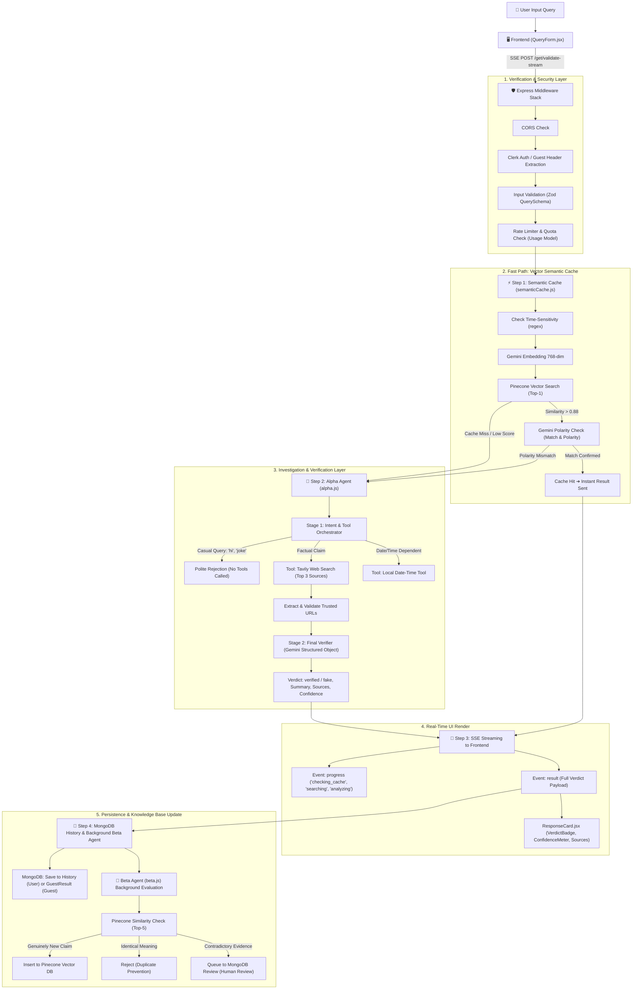

# 🔍 Sentinels of Truth — Complete Query Execution Flow

Is document mein explain kiya gaya hai ki jab user input box mein koi claim type karke **"Check it"** par click karta hai, to system ke andar step-by-step kya hota hai, kaunsa agent kab execute hota hai, aur final answer kaise generate hota hai.

---

## 🗺️ High-Level Architecture Flowchart



---

## 📋 Step-by-Step Breakdown

### 1. Frontend Submission (`QueryForm.jsx` & `streamVerify.js`)
1. User claim paste ya type karta hai (maximum 300 characters).
2. Type karte waqt debounced suggestions fetch hoti hain (`/sug/query`).
3. User **"Check it"** par click karta hai.
4. `streamVerify.js` backend ke endpoint `POST /get/validate-stream` ko connect karta hai Server-Sent Events (SSE) ke through:
   - **Headers:** Agar user signed in hai to Clerk JWT (`Authorization: Bearer <token>`) bheja jata hai; agar guest hai to persistent UUID (`X-Guest-Id`) bheja jata hai.
   - **Body:** `{ query: "...", skipCache: false }`.

---

### 2. Backend Middleware & Quota Gatekeeping
Endpoint par pahunchte hi request in stages se guzarti hai:
1. **CORS Middleware:** Localhost (`5173`, `3000`) aur production frontend origins ko check karke allow karta hai.
2. **`clerkMiddleware()` & `optionalAuth`:** Bearer token decode karke authenticated user ka `userId` extract karta hai (`req.user = { id }`).
3. **`validate(querySchema)`:** Zod schema se query validate hoti hai (non-empty string, min 1, max 300 characters).
4. **`verifyQuota`:**
   - **GAP Limiter:** Har query ke beech minimum 20-30 seconds ka cooldown enforce karta hai taaki spamming na ho.
   - **Daily Limit:** Signed-in users aur guests ke daily count ko track karta hai (MongoDB `Usage` collection ya in-memory fallback mein).

---

### 3. Step 1: Semantic Cache Check (`semanticCache.js`)
Fact check ko instant (sub-second) banane aur redundant AI API calls bachane ke liye:
1. **Time-Sensitive Guard:** Agar query mein `"today"`, `"now"`, `"aaj"`, `"latest"` jaise keywords hain, to cache bypass kar di jati hai taaki stale news na mile.
2. **Vector Embedding:** Query ko `embedded.js` ke through Google `gemini-embedding-2` model se 768-dimensional vector banaya jata hai.
3. **Pinecone Vector Query:** Pinecone index (`mydatabase`) se top match dhoonda jata hai.
4. **Polarity Check:** Agar vector similarity score `> 0.88` hai, to Gemini model se check karwaya jata hai ki dono claims ka factual meaning aur polarity same hai ya nahi (e.g., *"Earth is round"* vs *"Earth is flat"* dono vectorially close ho sakte hain, par polarity opposite hoti hai).
5. **Cache Hit:** Agar polarity confirm hoti hai, to backend turant `event: result` bhejta hai with `origin: "verified_db"`.

---

### 4. Step 2: Alpha Agent — The Investigator (`agent/alpha.js`)
Agar cache miss hota hai, to **Alpha Agent** trigger hota hai:

#### A. Decision & Search Orchestrator (`alphaDecision`)
- Frontend ko event stream hota hai: `event: progress { stage: "searching" }`.
- Gemini model (`gemini-2.0-flash` / `gemini-3.5-flash-lite`) agent mode mein chalta hai with 2 tools:
  - **`search` Tool:** Tavily Search API ko call karta hai real-time live web articles fetch karne ke liye (top 3 trusted sources).
  - **`date_time` Tool:** Aaj ki current local date aur time fetch karta hai taaki temporal context sahi rahe.
- **Casual Check:** Agar user ne sirf `"hi"`, `"hello"` ya `"tell me a joke"` likha hai, to model koi tool call nahi karta aur reply karta hai ki wo sirf factual claims verify karta hai.

#### B. Final Verification (`finalVerifier`)
- Frontend ko event stream hota hai: `event: progress { stage: "analyzing" }`.
- Gemini model ko evidence results aur original claim pass kiye jate hain.
- Model strict Zod schema enforce karke structured JSON return karta hai:
  ```json
  {
    "claim": "Original claim text",
    "verification_status": "verified" | "fake",
    "summary": "Evidence based clear explanation...",
    "sources": ["https://en.wikipedia.org/...", "https://bbc.com/..."],
    "confidence": 95
  }
  ```

---

### 5. Step 3: SSE Streaming to Frontend
Backend se event send hota hai:
```
event: result
data: {
  "success": true,
  "data": { ...verdict... },
  "query": "...",
  "origin": "web_search",
  "cached": false,
  "took_ms": 13582,
  "guestRemaining": 1
}
```
Frontend stream receive karke:
- `loading` state ko false karta hai.
- `ResponseCard.jsx` render karta hai:
  - **Verdict Badge:** True (Green) ya False (Red).
  - **Confidence Meter:** 0-100% score gauge.
  - **Summary:** Concise plain-English summary.
  - **Source List:** Original article links with publisher icons.
- Button par 20-second cooldown timer start hota hai.

---

### 6. Step 4: MongoDB History & The Beta Agent (`agent/beta.js`)

#### A. User / Guest History Persistence:
- **Signed In User:** Record MongoDB ke `History` collection mein save hota hai (`userId`, `claim`, `result`, `origin`, `tookMs`, `createdAt`).
- **Guest User:** Record MongoDB ke `GuestResult` collection mein save hota hai (`guestId`, `claim`, `result`, `tookMs`). Jab guest sign-in karta hai, to `adoptGuestHistory` isko permanent user history mein migrate kar deta hai.

#### B. Beta Agent — The Knowledge Base Custodian (`beta.js`):
Client ko answer milne ke baad backend background mein **Beta Agent** run karta hai:
1. Newly verified claim ko embed karta hai (768-dim vector).
2. Pinecone vector database query karta hai (Top 5 matches).
3. Gemini decision engine comparison karta hai:
   - **`insert`:** Agar ye ek naya verified fact hai, to ise vector DB mein save karta hai taaki future users ke liye instant cache hit ban sake.
   - **`reject`:** Agar same fact already database mein maujood hai, to duplication avoid karne ke liye reject kar deta hai.
   - **`human_review`:** Agar naya verdict database ke purane records se contradict karta hai, to ise MongoDB ke `Review` collection mein `status: "pending"` ke sath queue kar deta hai human reviewer ke liye.

---

## 📊 Summary Table of Components

| Component | File Path | Role |
|---|---|---|
| **Frontend UI** | `frontend/src/components/QueryForm.jsx` | Input capture, typewriter effects, state management, SSE handling |
| **Stream Client** | `frontend/src/utils/streamVerify.js` | SSE connection, chunk decoding, error retries |
| **Server Entry** | `Backend/src/index.js` | CORS, Clerk auth, routing, rate limiters |
| **Verify Controller**| `Backend/src/controllers/verify.js` | SSE heartbeat, cache evaluation, agent invocation, history saving |
| **Semantic Cache** | `Backend/src/utils/semanticCache.js` | Time-sensitivity guard, vector match, polarity comparison |
| **Alpha Agent** | `Backend/src/agent/alpha.js` | Fact verification, tool orchestration (Tavily search), structured output |
| **Beta Agent** | `Backend/src/agent/beta.js` | Vector DB curation (insert, reject duplicate, flag human review) |
| **Databases** | MongoDB Atlas & Pinecone | History, quota tracking, human reviews & vector embeddings |
